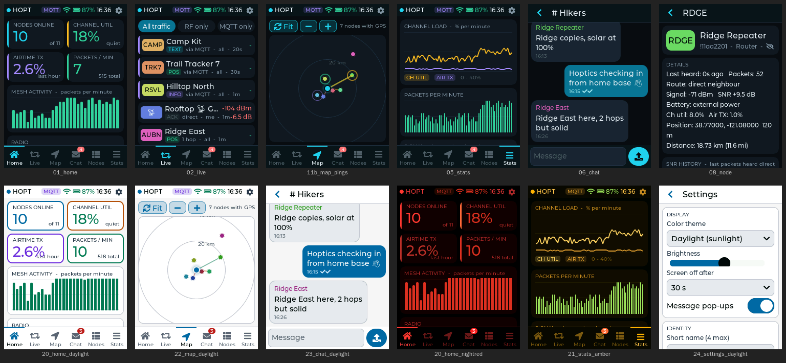
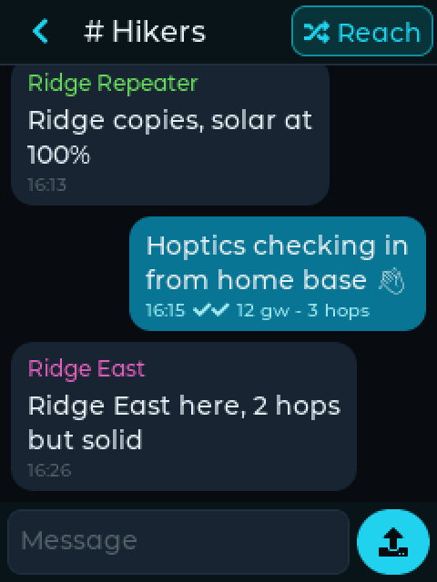
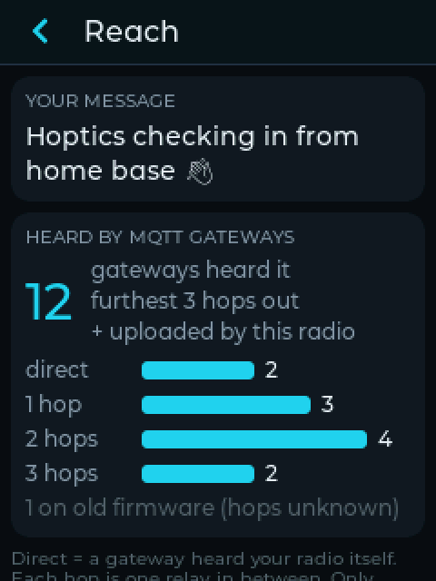
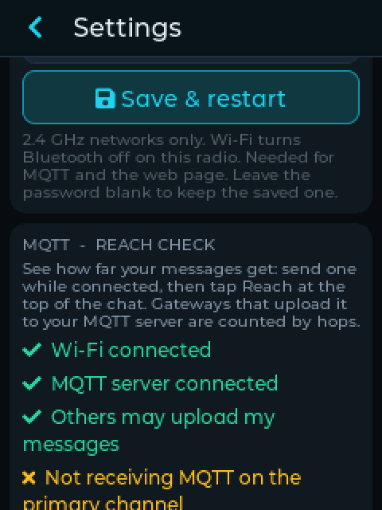
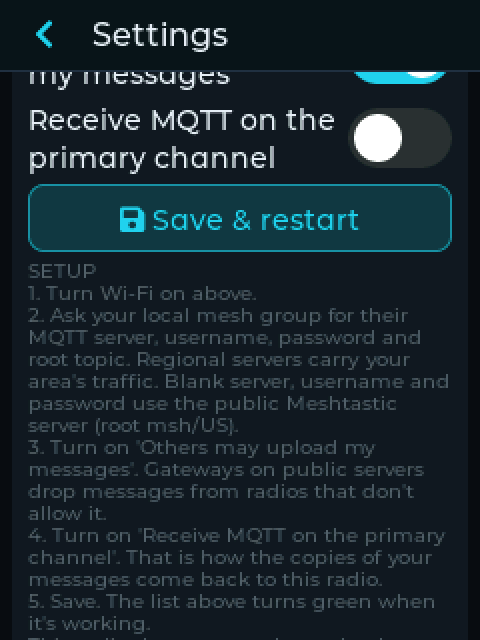
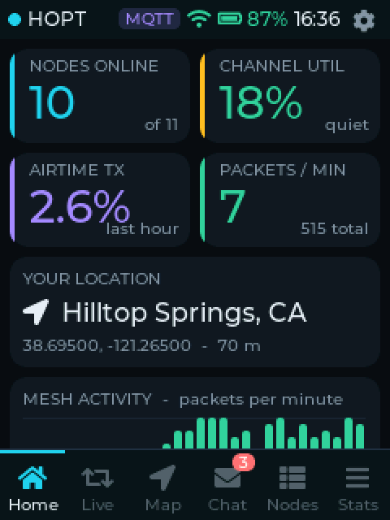
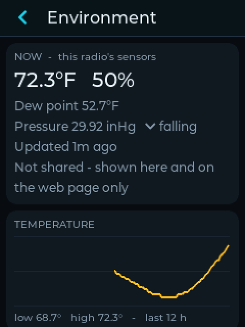
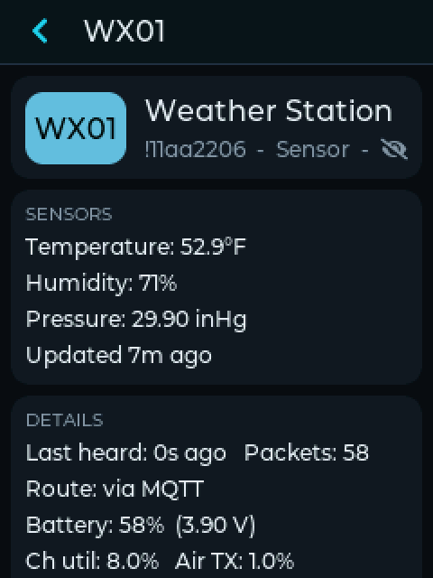
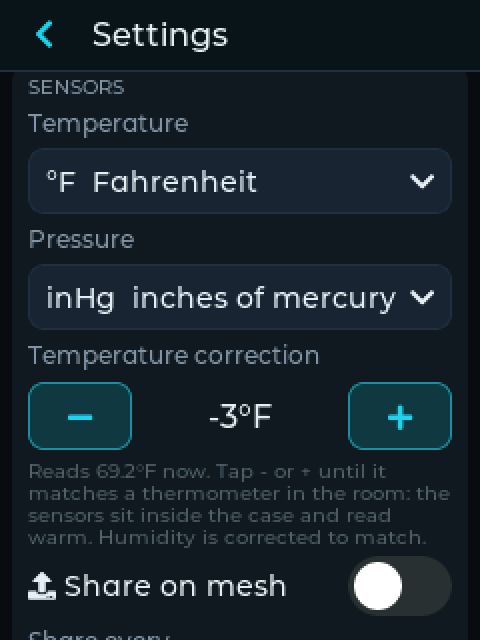
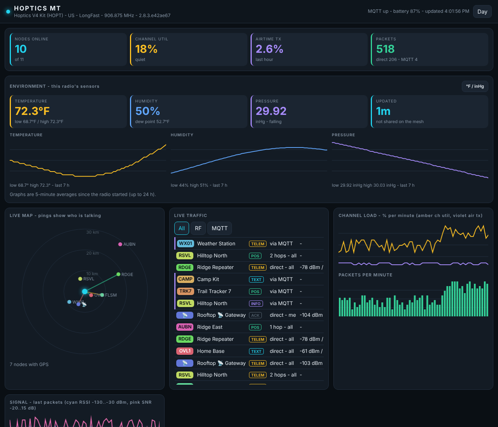

# Hoptics MT

A from-scratch UI for **Meshtastic** on the Heltec 2.8" touch kits, the LilyGO T-Deck Plus and the Elecrow
ThinkNode M9, built because the stock screen experience on the V4 Expansion Kit wasn't good enough. It's a personal build, not affiliated
with the Meshtastic project.

| Board | Build target | Notes |
|---|---|---|
| Heltec WiFi LoRa 32 **V4 Expansion Kit** (original, touch) | `heltec-v4-tft` | 2 MB PSRAM, 60-minute graphs |
| Heltec **V4-R8 Expansion Kit V2** (touch, SD slot) | `heltec-v4-r8-tft` | 8 MB PSRAM, 120-minute graphs, more nodes |
| LilyGO **T-Deck Plus** (keyboard, trackball, touch, GPS) | `t-deck-plus-tft` | **Beta**, new in v0.3.0: 320x240 landscape, keyboard + trackball + touch ([notes](#t-deck-plus-and-thinknode-m9-beta)) |
| Elecrow **ThinkNode M9** (keyboard, LR1110, GPS) | `thinknode_m9-tft` | **Beta**, new in v0.3.0: 320x240 landscape, keys only (no touch) ([notes](#t-deck-plus-and-thinknode-m9-beta)) |

It replaces both BaseUI and MUI. Everything else (radio, routing, encryption, MQTT, the phone apps)
is upstream Meshtastic 2.8.3, unchanged.



## What you get

**First boot**: a setup wizard asks for your **region** (the radio stays silent until it's set), your
**names** and a **theme**. No phone app needed.

**On the device (6 tabs)**
- **Home**: nodes online, channel utilisation, your airtime, packets per minute, the **Environment**
  card (below), a 30-minute activity graph, radio summary (region, preset, frequency, hop limit, power)
  and last-heard list.
- **Environment sensors**: the kits take plug-in sensor modules inside the case: a BME280
  (temperature, humidity, pressure) and a GXHTC3 (temperature, humidity). The V4-R8 Kit V2 has two
  module slots (its buzzer and GPS are built in); the V4 Expansion Kit has three (buzzer, BME280,
  GXHTC3). Home shows the reading in °F or °C, humidity,
  pressure (inHg or hPa) with a rising/falling arrow, and a graph. Tap it for 24 hours of temperature,
  humidity and pressure graphs, the dew point, the 3-hour pressure trend, and a list of **other nodes
  that share readings** on the mesh. Readings stay on your radio (screen and web page) unless you turn on
  **Share on mesh** in Settings > SENSORS (every 30 min to 12 h). Nodes that share readings show them on
  their node page. Because the sensors sit inside the case they read warm, so Settings > SENSORS also
  has a **temperature correction**: tap − or + until it matches a thermometer in the room (humidity is
  corrected to match, and shared readings use the corrected values).
- **Live**: every packet as it's heard, like a DMR hotspot last-heard list: who, packet type, direct
  or how many hops, RSSI/SNR. Filter All / RF only / **MQTT only** (MQTT rows have a violet edge).
- **Map**: nodes that share GPS are plotted around you on an OpenStreetMap street map (themed to match:
  dark, daylight, night-red, amber), with range rings. Drag to look around, Fit to come back. Tiles
  download over Wi-Fi only for what you are looking at (OSM's tile policy forbids prefetching), are
  checked against pinned root CAs, and are saved on flash (up to 1.5 MB, always leaving 1 MB free) so
  viewed areas still show without Wi-Fi. Settings > MAP turns it off or clears the saved tiles. Direct
  neighbours get a link line coloured by SNR, and **every packet makes its sender ping**, so you can
  watch where traffic comes from. RF pings are coloured by packet type, MQTT pings are violet, and a
  direct packet flashes a beam to you. Tap a dot for that node.
- **Chat**: channels and direct messages, bubbles with delivery ticks, on-screen keyboard, and pop-ups
  for new messages. With MQTT set up, your own messages also show their **reach** (below).
- **Reach check** (how far did my message get?): when the radio is on Wi-Fi and receiving your MQTT
  server's traffic, every gateway that hears one of your messages and uploads it sends a copy back.
  Hoptics counts those copies: your message bubble shows `12 gw - 3 hops`, and tapping it (or **Reach**
  at the top of the chat, for your latest message) shows how many gateways heard it **directly, 1 hop,
  2 hops...** out. It's deliberately light: only messages
  sent from this screen are tracked, and the check costs one compare per MQTT packet. The **V4** keeps
  counts for its last 6 messages; the **V4-R8** (and the T-Deck Plus and ThinkNode M9 builds) keep the
  last 24 and also list **which gateways** heard each one. The web page has the full **Reach logger**.
- **Settings > MQTT**: set up MQTT on the radio itself, no phone app: server, username, password, root
  topic, and the two switches the reach check needs, with a live checklist that turns green as each
  part works and step-by-step directions underneath (see [Setting up MQTT](#setting-up-mqtt-and-the-reach-check)).
- **Nodes**: sort by recent, signal, hops or name. Node detail shows sensor readings (if the node shares
  them), signal, battery, channel use, position, distance, an SNR history graph, and buttons for **DM**,
  **Trace route** and **Request position**.
- **Stats**: channel load and airtime over time, packets per minute, RSSI/SNR of recent packets,
  nodes by hop count, traffic mix, and **top talkers** (who is using the airtime).
- **Settings** (gear icon): theme, brightness, screen timeout, message pop-ups and **message sound**
  (each plays a sample), sensor units and sharing, names, region, preset, role, Wi-Fi, Bluetooth (with a fresh random PIN shown
  on screen), street map, web chat sharing, reboot and power off (two-tap confirm), and
  **Report a problem** (see below).
- **City locator** (offline, like WADAMESH): a "Now in <town>" pop-up when you arrive somewhere new,
  your town on Home, and "Near: 13 km NE of <town>" for other nodes. Uses GeoNames towns of 5,000+
  people built into the firmware, so it needs no internet. It's also shown on the web page.
- **Themes**: Midnight (dark), **Daylight** (high-contrast dark-on-white for direct sun), **Night Red**
  (red-only, keeps night vision) and Amber terminal.

**On your network** (when the node is on Wi-Fi): open `http://<node-ip>/hoptics` for a live dashboard
in the same style: tiles, **environment readings and 24-hour sensor graphs** (with a °F/°C switch),
sensors shared by other nodes, live map with pings, traffic feed with the MQTT filter, charts, sortable
node table, and day/night toggle (`/hoptics?day` to bookmark day mode). It's read-only.
The **Reach logger** card lists your messages with their gateway count, a hops histogram and how far out
they got; click one for the breakdown and (V4-R8) the gateways by hops. It keeps a longer history in your
browser than the radio does (up to 300 messages per radio) and exports it as CSV.

| Message reach | Reach detail | Settings > MQTT | MQTT setup steps |
|---|---|---|---|
|  |  |  |  |

| Home | Environment | Node with sensors | Settings > SENSORS |
|---|---|---|---|
|  |  |  |  |



**Discord and loggers**: `tools/hoptics_bridge.py` runs on any PC or Pi on the same Wi-Fi. It posts new
nodes and (optionally) channel chat to a Discord webhook, and/or writes JSON-lines logs for Grafana,
InfluxDB or a spreadsheet. See [Discord / logging](#discord--logging).

## Setting up MQTT and the reach check

Everything is on the radio in **Settings > MQTT** (the same settings the Meshtastic app has, if you prefer
that):

1. **Wi-Fi on** (Settings > Wi-Fi). MQTT needs the internet.
2. **Server, username, password, root topic**: ask your local mesh group. Regional servers carry your
   area's traffic (for example the Bay Area mesh uses its own server and the root `msh/US/bayarea`).
   Leave the server, username and password blank to use the public Meshtastic server (root `msh/US`).
3. **Others may upload my messages** on. This is Meshtastic's *OK to MQTT*. Gateways connected to public
   servers drop messages from radios that don't allow it, so without it nobody uploads you.
4. **Receive MQTT on the primary channel** on. This is the channel's *downlink*: it's how the copies of
   your messages come back to the radio. Your radio does **not** need to upload (uplink) itself.
5. **Save & restart**. The checklist at the top of the card turns green as each part works. Then send a
   channel message and watch your bubble.

Traffic that arrives over MQTT shows on screen (Live > MQTT only, violet) but Hoptics never re-sends it
over LoRa, whatever the server. The password is never shown on the screen or the web page; leave it blank
to keep the saved one.

## Install (easiest)

Open the **one-click installer** in Chrome or Edge on a computer:
**https://languskhan.github.io/hoptics-mt/**

Plug the kit in, click the button for your kit, pick its port, and it flashes the latest release. First
time on Hoptics: tick **Erase** (clean start, new keys). Updating: leave Erase unticked and everything is
kept, including the screen's own settings. The setup wizard takes over on the screen after that.

Other ways, from the latest [release](https://github.com/Languskhan/hoptics-mt/releases):
**START-HERE-Hoptics-MT-install-guide.html** walks through it with the Meshtastic Web Flasher (`.update.bin`,
if you're already on Meshtastic 2.6+) or Espressif's ESP Tool page (`.factory.bin` at `0x0` plus
`mt-esp32s3-ota.bin` at `0x650000`). The release also has a PDF user guide with screenshots of every screen.

## Flashing by hand

1. Download the `.factory.bin` for your board from the latest release (or the build artifacts).
2. Put the board in bootloader mode: hold **USER**, tap **RST**, release **USER**.
3. Flash the **factory** image at `0x0` **with a full erase**. These are the same offsets Meshtastic's own
   `bin/device-install.sh` (factory at `0x00`) and `bin/device-update.sh` (update at `0x10000`) use:
   ```bash
   esptool --chip esp32s3 erase-flash
   esptool --chip esp32s3 write-flash 0x0 hoptics-mt-<board>-mt2.8.3.factory.bin
   ```
   (older esptool spells these `erase_flash` / `write_flash`). Espressif's browser flasher
   (https://espressif.github.io/esptool-js/) works too: Erase, then add the file at offset `0x0`.
   - A full erase also makes the radio generate **new encryption keys**. Some vendors' factory
     flashing produced devices with duplicate key pairs (CVE-2025-52464), so this is worth doing once.
4. After first boot, open **Settings → Radio → Region** and set your region (US etc.).
5. Later updates: `esptool --chip esp32s3 write-flash 0x10000 hoptics-mt-<board>-...update.bin` (no erase), and your settings are kept.

The official Meshtastic web client normally served at `http://<node-ip>/` lives in a separate file-system
image that this build doesn't ship. Use https://client.meshtastic.org, the phone apps, or `/hoptics`.

Flashing back to stock Meshtastic works as usual (web flasher, "Heltec V4 TFT", MUI on).

## Reporting problems

- **On the radio**: Settings → DEVICE → **Report a problem** shows a QR code. Scan it with your phone and
  GitHub opens a bug report with the firmware version, build, board, uptime and free memory already
  filled in. Add what you were doing and submit.
- **After a crash** the radio shows a **Crash report** screen by itself when it comes back up: what went
  wrong (for example `abort() in loopTask, 12 s after start`), the crash address and backtrace from the
  ESP32's core dump, and how much memory was free just before. Its QR code files the report. It also
  spots restart loops ("It keeps restarting") and power dips (brownouts). Settings → DEVICE keeps
  showing the last crash until you clear it.
- **No GitHub account?** Take a photo of the report screen: the same details are printed under the code.
- Reports never include your node number, position or Wi-Fi name, and nothing is sent from the radio.
- Each build keeps its symbol file (`.elf`, attached to releases and kept 90 days with build
  artifacts), so the addresses in a report can be turned into function names:
  `xtensa-esp32s3-elf-addr2line -pfiaC -e hoptics-mt-<board>-mt2.8.3.elf 0x421e9caf 0x421e9ce4 ...`

## Updates, stable and beta

- **Tested** builds (every push and release) are built on the Meshtastic version listed in
  `.github/workflows/build.yml`, which these patches were written and checked against.
- **Newer Meshtastic**: Hoptics is pinned to Meshtastic 2.8.3, which is newer than Meshtastic's current
  stable (2.7.x) and alpha (2.8.2) releases. When a newer Meshtastic release comes out, Hoptics moves to it
  after the patches are rebuilt and tested on both kits. (`build.yml` can also be run by hand from the
  Actions tab with any Meshtastic tag, to try one early.)
- **Over Wi-Fi**: the installer also writes Meshtastic's unified OTA loader (same file and slot as
  upstream), so ESP32 Wi-Fi/BLE OTA works. Push an `...update.bin` from the Meshtastic Android app's
  firmware update screen or the Meshtastic Python CLI's ESP32 Wi-Fi OTA (meshtastic/python PR #898).
  The node can't safely download and flash itself: the 16 MB layout has one app slot plus the loader, so
  there's nowhere to stage a self-download while running.

## Security

Short version (details and sources in [docs/SECURITY.md](docs/SECURITY.md)):
- Stock Meshtastic's built-in web server has **no login**, and its API answers **any website** your
  browser has open (`Access-Control-Allow-Origin: *`). Hoptics MT keeps the API for the official web
  client, but only lets `client.meshtastic.org` talk to it from a browser. It also makes **reboot,
  file upload and file delete HTTPS-only**.
- The `/hoptics` page and `/json/hoptics` are read-only and send strict browser security headers. All
  names and messages are rendered as plain text; a hostile node name or message can't inject script
  (tested).
- **Direct messages are never exported** to the web page or bridge. Channel chat is only shared if you
  switch on Settings → Web page → "Show channel chat on web".
- Bluetooth pairing uses a **new random 6-digit PIN** each time you enable it, shown in Settings.
- The Discord webhook stays on the computer running the bridge, never on the radio. The bridge
  blocks `@everyone` / role pings and escapes Discord markdown.
- Not fixed (it's upstream Meshtastic): the TCP API on port 4403 has no authentication when Wi-Fi is
  on. Keep Wi-Fi-enabled nodes on a network you trust.

## Discord / logging

```bash
# on a Pi on the same Wi-Fi as the node
export HOPTICS_DISCORD_WEBHOOK='https://discord.com/api/webhooks/...'   # keep it out of shell history/scripts you share
python3 tools/hoptics_bridge.py 192.168.1.57 --status-every 3600 --log mesh.jsonl
python3 tools/hoptics_bridge.py 192.168.1.57 --no-discord --log mesh.jsonl   # logging only
```
For a two-way Discord bot or MQTT-based logging there are mature projects already; see
[docs/EVIDENCE.md](docs/EVIDENCE.md#discord-and-loggers).

## How it's built

- `patches/device-ui.patch`: adds `HopticsUI` (pure LVGL screens, no protobufs) and `HopticsView`
  (adapter to the device-ui controller), enables LVGL charts and extra font sizes, and makes the view
  factory pick Hoptics when `-DHOPTICS_UI` is set.
- `patches/firmware.patch`: forces the colour UI at boot (stock firmware can leave a V4 TFT stuck
  on BaseUI if the saved config says so), adds `/hoptics` + `/json/hoptics`, and applies the web hardening.
- `web/hoptics.html`: the web dashboard (embedded into the firmware at build time).
- `.github/workflows/build.yml`: fetches pinned upstream firmware and device-ui, applies the patches,
  and builds every board. Boards marked `untested` are built but not attached to releases.
- `harness/`: renders every screen on a PC with fake data (that's how the screenshots were made).
- `.github/ISSUE_TEMPLATE/bug.yml`: the bug report form the radio's QR codes open (its field ids match
  the link the radio builds).
  Measured LVGL memory: about 350 KB in use of the V4 kit's 1.4 MB pool, peaking at about 700 KB during
  a theme switch, with no growth after repeated switches.

## Tested so far

- **Rendering**: every screen in all 4 themes, rendered on a PC with the real UI code (see `harness/`).
- **Stress simulation** (`harness/stress.cpp`, built with AddressSanitizer + UBSan): an 8-hour session with
  400 nodes against the 300-node cap (eviction tested), hostile/emoji/oversized names, 111k packets
  including a 30-packets-per-second flood every hour, 1,253 messages, constant tab and overlay switching,
  the keyboard, node removals, and a theme switch every 15 minutes. **No crashes, no sanitizer errors,
  and LVGL memory flat at about 466 KB** after fixing an unbounded DM-conversation list the simulation found.
- **City lookup**: 20,000 random positions checked against brute force on a 50,000-town table, all matched.
- **Web page**: rendered in headless Chrome under the same security headers the node sends, with an
  injection test (hostile names and messages stay plain text).
- **Discord bridge**: run against a fake webhook (mentions blocked, markdown escaped, JSON log written).
- **Adapter**: compiles against the real device-ui sources (Linux build).

## Status

v0.3.3: **SD card**: map tiles are kept on the card, and ready-made map packs show (Meshtastic's /maps/<style>, /map, or MeshCore's /tiles). **Files over Wi-Fi** (Settings > Storage): browse, upload (files or whole folders), download and delete on the card from a browser, with a code shown on the radio; off by itself after 15 minutes unused or a restart. **Tap to wake** on the Heltec V4 kits.

v0.3.2: on the **ThinkNode M9** the arrow keys move the focus freely by screen position, all four ways
(the map's zoom buttons, the tab bar, the Settings gear).

v0.3.1: **every Meshtastic 2.8 preset and region**, each region with exactly the presets it allows, including
the ham 70 cm and 1.25 m bands (licensed mode). A **country picker** sets a legal region, and **local mesh**
presets set region, preset and slot for community meshes in one tap. **Full MQTT set-up** (uplink, downlink,
encryption, TLS, JSON, map report, proxy, OK to MQTT) and **all Meshtastic settings** on one page. Steadier
touch on the Heltec V4 kits and T-Deck, and **tap to wake** on the V4 kits. Receive-only mode, signed-packet
policy and the 24-byte long-name limit.

v0.3.0: the **LilyGO T-Deck Plus** and the **Elecrow ThinkNode M9** (beta): a 320x240 landscape layout, full
keyboard and trackball control, a GPS switch in Settings, and the M9's location key (a new Location card).
Radios on USB or a charger now stay awake with the screen off (light sleep only on battery).

v0.2.4: the **reach check** (how far your messages get, counted from MQTT gateways, by hops), **MQTT
set-up on the radio** with a live checklist, and the **Reach logger** on the web dashboard. Fixes the
V4-R8's microSD slot (it now reads, at 4 MHz), overlapping text on Home and Live, and the Amber theme's
green. v0.2.3 fixed the V4-R8's slow Wi-Fi after boot and added the one-click web installer; v0.2.2 added
the environment sensors and the web dashboard.

### T-Deck Plus and ThinkNode M9 (beta)

Both install from the [web installer](https://languskhan.github.io/hoptics-mt/) like the Heltec kits.
- **Installing**: a radio coming from MeshCore (or anything other than Meshtastic) needs the installer's
  **erase** option. The **T-Deck** sometimes stays dark after the installer restarts it: slide the power switch
  off and on. The **M9**'s first start updates its LoRa chip (about 10 seconds): keep it plugged in.
- **Screen**: 320x240 landscape, with the tabs in a rail on the left.
- **Keys** (the M9 has no touch screen, so everything works from keys):
  - Arrows / trackball: move the highlight. **Enter** / trackball press: press it. **Esc**, or Backspace outside
    a text field: back. On the main screen, Left / Right switch tabs and the letters **h l m c n s** jump to
    Home, Live, Map, Chat, Nodes, Stats. In a chat, just type.
  - Map: highlight it and press Enter to pan with the arrows (+ and - zoom).
  - **M9 top keys**: Home, Chat, Map, quick message, and the **location key**: a short press opens the
    Location card (GPS state, fix, your coordinates; Show on map, Send position, GPS on/off), a long press
    turns GPS on or off.
  - The key that wakes a dark screen only wakes it.
  - The accent key (Shift+$ on the T-Deck) cycles the accent of the letter before the cursor.
- **GPS**: built in on both and on by default; **Settings > Radio** has a GPS switch. (The T-Deck Plus build
  should also run on an original T-Deck, which just finds no GPS.)
- **Sound**: T-Deck through its speaker, M9 through its buzzer.
- **Environment sensors**: neither has one, so the Environment card shows readings shared on the mesh.
- **Power**: on battery, both use Meshtastic's power saving like stock firmware (light sleep while the screen
  and Wi-Fi are off). A trackball press (T-Deck) or any key (M9) wakes them. On USB or a charger they stay
  awake.

Feedback welcome: use **Report a problem** on the radio, or
[open an issue](https://github.com/Languskhan/hoptics-mt/issues/new?template=bug.yml).

**Next (planned)**: Wi-Fi file manager for the V4-R8's SD card (logs, map tiles), and optional offline
map tiles on the R8.

## Support the project

Hoptics MT is free. If it's useful to you, you can
[buy me a coffee](https://buymeacoffee.com/Bluffs) (there's also a QR code at the bottom of Settings on
the radio, and a link at the bottom of the web dashboard). Bug reports and testing on more kits help just
as much.

License: GPL-3.0 (same as Meshtastic firmware and device-ui). City data © GeoNames (https://www.geonames.org),
CC BY 4.0.

## The website

The site in `site/` (home page, firmware list and browser flasher) is published to GitHub Pages by
`.github/workflows/pages.yml`, with the latest release's firmware. To change it, edit and push to `main`:

- `site/updates.json`: the "What's happening" cards. Newest first; `tag` is `released`, `progress` or `coming`.
- `site/nodes.json`: one entry per node. Copy an entry to add a node; `status` is `available` or `soon`,
  `platform` is `meshtastic` or `meshcore`, `flash` is `esp` (browser flasher) or `uf2` (download and drag).
  An `available` node needs a matching factory image in the latest release; a `soon` node gets no files on
  the site even if the release has them.
